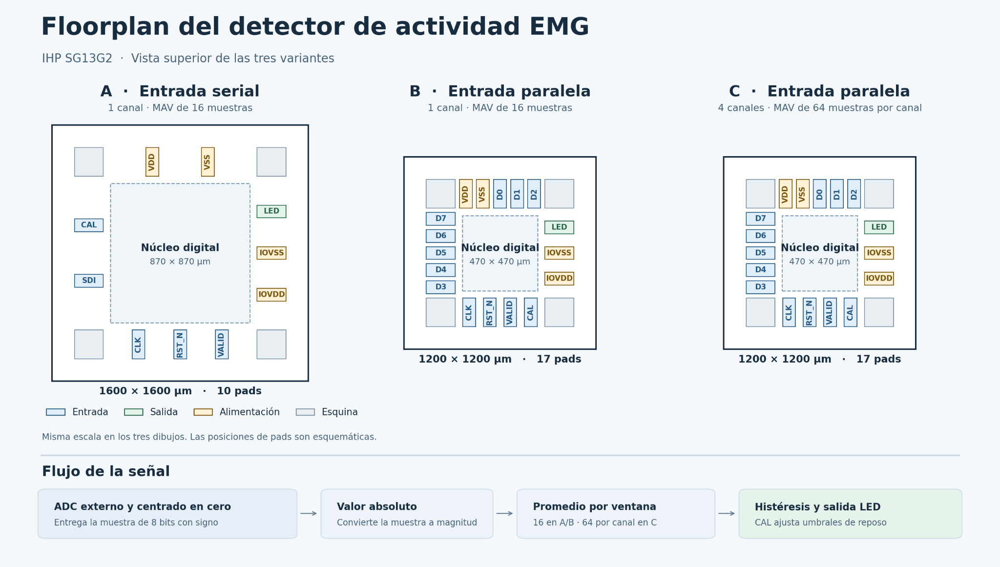

# Detector EMG de 8 bits en IHP SG13G2

## Floorplan



| Variante | Die (µm) | Área de colocación (µm) | Entradas | Salidas | Alimentación | Total |
| --- | --- | --- | ---: | ---: | ---: | ---: |
| A · serial | 1600 × 1600 | 870 × 870 | 5 | 1 | 4 | 10 |
| B · paralela | 1200 × 1200 | 470 × 470 | 12 | 1 | 4 | 17 |
| C · paralela de cuatro canales | 1200 × 1200 | 470 × 470 | 12 | 1 | 4 | 17 |

El LEF de SG13G2 da 80 µm a lo largo del perímetro y 180 µm hacia el
interior para las celdas I/O elegidas. Las esquinas son de 180 × 180 µm.
Con el retranqueo de 140 µm de la librería, el tramo útil entre
esquinas es 960 µm en A y 560 µm en B. En B, 5 pads de 80 µm dejan
160 µm para repartir en el lado más ocupado. OpenROAD coloca los
fillers del anillo con los anchos discretos del PDK (1, 2, 5, 10, 20 y
50 µm). El relleno de densidad metálica es una etapa distinta.
Las posiciones del dibujo son aproximadas. Los 1200 µm son un punto de
partida para comprobar con routing, DRC y las reglas de encapsulado.

## Layouts en OpenROAD

| A · Entrada serial | B · Entrada paralela | C · Cuatro canales |
| --- | --- | --- |
|  |  |  |
| 1600 × 1600 µm · 10 pads | 1200 × 1200 µm · 17 pads | 1200 × 1200 µm · 17 pads |

Las capturas muestran los layouts preliminares. B y C comparten el
contorno y la distribución de pads. C incluye la lógica de cuatro canales.

## Pines y funcionamiento

| Señal | Función |
| --- | --- |
| CLK | Reloj de 1 MHz para muestreo digital y temporizador del botón. |
| RST_N | Reset síncrono activo en cero. Reinicia el receptor y el detector. |
| VALID | Captura en cada flanco ascendente de CLK con VALID alto. En A se acepta un bit y en B y C se acepta una muestra completa. |
| SDI (A) | Un bit por flanco válido, desde bit 7 hasta bit 0. El reset alinea el primer bit. |
| D[7:0] (B y C) | Muestra paralela en complemento a dos. |
| CAL | Botón activo en alto. Un nivel alto durante 3 s a 1 MHz inicia una calibración. |
| LED | Salida activa en alto cuando se detecta actividad. |
| VDD, VSS | Alimentación y tierra del núcleo (1.2 V nominal). |
| IOVDD, IOVSS | Alimentación y tierra de los pads (3.3 V nominal). |

El origen de las muestras es externo. Un ADC y un microcontrolador, por
ejemplo, pueden centrar las muestras en cero y enviar los datos firmados
con VALID sincronizado a CLK. A 2 kS/s, el MAV se actualiza cada 8 ms.

En A y B, el detector acumula 16 magnitudes en un registro de 12 bits y toma sus
8 bits superiores. Arranca con umbrales de 12 y 20 cuentas. Enciende LED
cuando MAV ≥ 20 y lo apaga cuando MAV ≤ 12, usando los valores vigentes.
Al iniciar la calibración, apaga LED y empieza una ventana nueva. Mantén
el músculo en reposo durante esa ventana. Al completarla, ajusta los
umbrales a MAV de reposo + 4 y + 8 cuentas. Entrar otra vez en calibración
requiere liberar el botón y mantenerlo presionado de nuevo. Los umbrales
se reinician con RST_N y se pueden ajustar en el RTL tras evaluar datos EMG.

## Variante C de cuatro canales

La variante C reutiliza la interfaz paralela y la distribución de pads
de B. Después de RST_N, el emisor envía CH0, CH1, CH2 y CH3 en ese orden
y repite la secuencia. Se acepta una muestra en cada flanco ascendente
con VALID alto. VALID bajo permite hacer pausas entre muestras. Si se
pierde una muestra válida o el orden se desincroniza, el emisor debe
aplicar RST_N y reiniciar la secuencia con CH0. El reset recupera los
umbrales iniciales.

C comparte el cálculo de valor absoluto y la suma, y mantiene un
acumulador de 14 bits y dos umbrales por canal. Calcula el MAV cada
64 muestras por canal. A 2 kS/s por canal son 32 ms por ventana.
El LED se enciende cuando al menos un canal está activo. Cada canal
mantiene su estado hasta que cruza el otro umbral de histéresis.

CAL sostenido durante 3 s a 1 MHz apaga el LED, descarta la ventana
parcial y empieza a medir reposo desde el siguiente CH0. Cada canal
actualiza sus umbrales a su MAV de reposo + 4 y + 8 cuentas. Cuando el
MAV de reposo de un canal supera 120, ese canal conserva sus umbrales
previos para que el umbral alto siga siendo alcanzable. El LED vuelve
a indicar actividad al procesar nuevas ventanas de detección.

Los acumuladores y umbrales se sintetizan en registros. El núcleo usa
celdas estándar. El anillo usa las celdas físicas I/O de IHP y el
bondpad de la plantilla.

Para simular y ejecutar el flujo preliminar de C en Docker:

```bash
cd /foss/designs/emg-mav-ihp-sg13g2
make CHIP=c PDK=ihp-sg13g2 sim synth layout
make CHIP=c PDK=ihp-sg13g2 openroad
```

`make CHIP=c waves` abre la simulación C en GTKWave. Bajo
`tb.dut.core` se pueden ver `channel[1:0]`, `mav[7:0]`, `active[3:0]`
y `calibrating`.

## Ejecutar en el contenedor

Usa la terminal Linux del contenedor de IIC-OSIC-TOOLS. El Makefile utiliza
el PDK bajo `/foss/pdks` por defecto. Si tu PDK vive en otra ruta, pasa
`PDK_ROOT=/ruta` a make.

```bash
cd /foss/designs/emg-mav-ihp-sg13g2
sak-pdk ihp-sg13g2
make CHIP=a pad-dims sim synth
```

Para ver la simulación puedes ejecutar `make CHIP=a waves`. Agrega
`clk`, `valid`, `data`, `cal` y `led` en GTKWave. Bajo
`tb.dut.core` también puedes agregar `mav` y los dos umbrales.
El banco de pruebas usa ocho ciclos para simular la pulsación larga
y cubrir la lógica de calibración en un tiempo corto.

Genera una vista física preliminar para revisar el anillo, placement y
routing. Abre una herramienta gráfica a la vez.

```bash
make CHIP=a layout
make CHIP=a openroad
# Tras cerrar OpenROAD
make CHIP=a klayout
```

`layout` termina al exportar la vista GDS de KLayout, antes del relleno
de densidad, el seal ring y las verificaciones finales. `make CHIP=a full`
ejecuta el flujo completo y guarda sus vistas en `final/a/` si concluye.
Puedes revisar B con los mismos objetivos usando `CHIP=b`. Usa
`TAG=emg-a-prueba2` (u otro nombre nuevo) en `layout`, `openroad` y
`klayout` para mantener tu primera ejecución preliminar al hacer otra.
El valor inicial de JOBS es 2.

## Validación previa

Las tres variantes pasaron la simulación RTL con los modelos de pads
del IHP Open PDK. C pasó además la síntesis lógica genérica con Yosys.
La variante C usa una máscara de cuatro bits para actualizar el estado
de un canal. El objetivo `layout` exporta el GDS preliminar. El objetivo
`full` ejecuta las etapas de verificación física. Los umbrales son
valores de arranque para la demostración y requieren mediciones para
ajustarlos a la señal y al usuario.

El flujo y el bondpad de 70 × 70 µm proceden de la
[plantilla LibreLane de IHP](https://github.com/IHP-GmbH/ihp-sg13-librelane-template).
El [LEF del PDK](https://github.com/IHP-GmbH/IHP-Open-PDK/tree/main/ihp-sg13g2/libs.ref/sg13g2_io/lef)
describe las celdas de E/S, esquinas y fillers.
